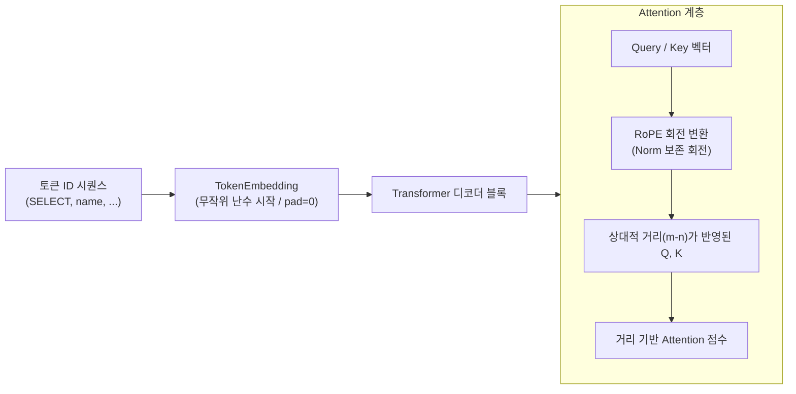
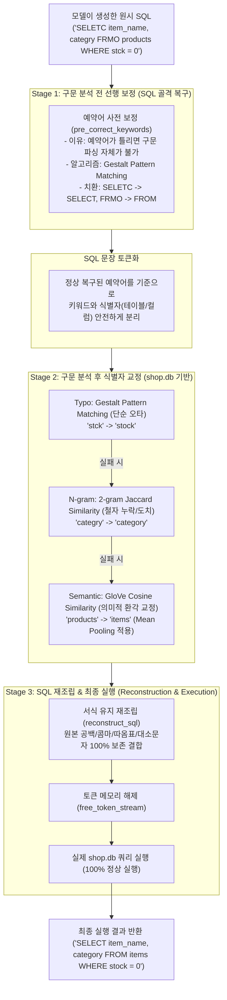

# SQL Post-processor C 구현 가이드

## 1. 아키텍처 및 모듈 구성

C 언어 기반 SQL 후처리기는 독립 라이브러리 및 상위 추론 파이프라인과 유기적으로 결합되어 있으며, `src/core/` 및 바인딩 계층에 다음과 같이 구성되어 있습니다:

### 1) 후처리기 코어 모듈 (`src/core/postprocessor/`)
| 파일명 | 역할 설명 |
| :--- | :--- |
| [`core.h`](../src/core/postprocessor/core.h) / [`core.c`](../src/core/postprocessor/core.c) | 전체 교정 파이프라인(`process_sql`) 제어 및 계단식 교정 레벨(`PostprocessLevel`) 오케스트레이션 |
| [`parser.h`](../src/core/postprocessor/parser.h) / [`parser.c`](../src/core/postprocessor/parser.c) | SQL 예약어 사전 보정(`pre_correct_keywords`), 토크나이저(`tokenize_sql`), 서식 보존 SQL 재구성기(`reconstruct_sql`) |
| [`replacement.h`](../src/core/postprocessor/replacement.h) / [`replacement.c`](../src/core/postprocessor/replacement.c) | 식별자 교정 전략 구현 (Typo: Gestalt Pattern Matching, N-gram: 2-gram Jaccard, Semantic: GloVe 코사인 유사도 & snake_case Mean Pooling) 및 전략 체이닝 |
| [`schema.h`](../src/core/postprocessor/schema.h) / [`schema.c`](../src/core/postprocessor/schema.c) | SQLite 데이터베이스로부터 테이블 및 컬럼 스키마 사전 동적 추출(`load_dictionary_from_sqlite`) |
| [`postprocessor.h`](../src/core/postprocessor/postprocessor.h) | `src/core/include/postprocessor.h`를 참조하는 내부 포워딩 헤더 |

### 2) 공개 인터페이스 및 상위 파이프라인 (`src/core/include/`, `src/core/pipeline/`)
| 파일명 | 역할 설명 |
| :--- | :--- |
| [`include/postprocessor.h`](../src/core/include/postprocessor.h) | 외부 공개용 C 라이브러리 인터페이스 헤더 (`process_sql`, `pre_correct_keywords`, `typo_correction`, `ngram_correction`, `semantic_correction` 등) |
| [`include/pipeline.h`](../src/core/include/pipeline.h) / [`pipeline/pipeline.c`](../src/core/pipeline/pipeline.c) | 모델 추론 $\rightarrow$ 후처리 $\rightarrow$ DB 실행을 원스톱으로 연결하는 상위 통합 실행 파이프라인 |

### 3) 상위 바인딩 및 단위 테스트
| 파일명 | 역할 설명 |
| :--- | :--- |
| [`SqlPipeline.cs`](../src/bindings/SqlEngine.Core/SqlPipeline.cs) | .NET 및 Uno Platform 데스크톱 GUI(`SqlApp`) 연동을 위한 C# P/Invoke 바인딩 계층 |
| [`tests/test_postprocessor.c`](../tests/test_postprocessor.c) | 예약어 보정, 식별자 교정, 복합 오타, n-gram, 체이닝, semantic fallback 등 17개 검증 시나리오 C 단위 테스트 |

---

## 2. 알고리즘 1:1 대응 원리

1. **SQL 예약어 사전 보정 (`pre_correct_keywords`)**:
   - `SELECT`, `FROM`, `WHERE` 등 표준 SQL 예약어 리스트(`PRIMARY_KEYWORDS`)를 대상으로 `difflib.SequenceMatcher`와 동일한 Gestalt Pattern Matching 알고리즘을 수행하여 유사도 $\ge 0.7$일 때 오타를 사전 교정합니다 (예: `SELETC` $\rightarrow$ `SELECT`, `FRMO` $\rightarrow$ `FROM`).
   - 원래 토큰의 대소문자(전체 소문자 여부)를 유지합니다.

2. **식별자 토큰 추출 및 교정**:
   - 쿼리를 단어, 문자열 리터럴, 기호, 공백 등으로 분해하여 키워드가 아닌 단어를 식별자(테이블/컬럼명)로 인식합니다.
   - 원본 대소문자 속성(`is_all_upper`)을 기록하여 교정 후 원래 대소문자에 맞게 복원합니다.

3. **5단계 계단식 교정 전략 (Cascading Strategies)**:
   - 교정 전략은 반드시 **왼쪽에서 오른쪽으로 순차적으로 누적 적용**됩니다:
     * **Stage 0: `none`**: 원본 SQL 유지 (구 `generate` 모드와 동일, 후처리 미적용)
     * **Stage 1: `keyword`**: 표준 SQL 예약어 사전 보정만 수행 (`SELETC` $\rightarrow$ `SELECT` 등)
     * **Stage 2: `typo`**: 예약어 보정 + SQLite DB 스키마 기반 Levenshtein/Gestalt 비율 유사도 교정 (cutoff $\ge 0.7$)
     * **Stage 3: `ngram`**: 예약어 + Typo + Jaccard 2-gram 유사도 매칭 (cutoff $\ge 0.3$)
     * **Stage 4: `semantic`**: 예약어 + Typo + N-gram + GloVe 단어 임베딩 코사인 유사도 교정
   - **체이닝 규칙**: 단일 이름(`keyword`, `typo`, `ngram`, `semantic`, `none`) 또는 누적 순서(`keyword,typo`, `keyword,typo,ngram` 등)로 지정할 수 있으며, 뒤쪽 옵션은 생략 가능하나 중간 단계를 건너뛰거나 순서를 역전할 수는 없습니다.

---

## 3. 심층 기술 자료: 임베딩 계층 및 C 후처리기 상세 (Deep-Dive Guide)

본 절은 발표 자료(슬라이드 및 대본) 및 기술 심층 분석을 위한 기술 정리 자료입니다. 복잡한 수식 전개는 배제하고, 각 알고리즘의 **핵심적인 결론**과 **수식이 갖는 본질적인 의미 및 개념적 의의**를 직관적으로 정리했습니다.

### 3.1 `capstone-design-1`: 임베딩 모듈 (`src/models/embedding.py`)

#### 1) 핵심 역할 및 개념적 의의 (Role & Significance)

이 모듈은 Transformer 디코더 모델에서 **텍스트를 고차원 좌표 공간으로 변환하고, 단어 간의 '상대적 거리감'을 심어주는 입력 관문**입니다.

##### 1. 토큰 임베딩 (`TokenEmbedding`) & Weight Tying
- **역할**: 이산적인 토큰 ID를 고차원(512차원) 연속 벡터 공간의 의미 좌표로 매핑합니다.
- **초기화 및 예외**: 모든 일반 단어 벡터는 **완전한 무작위 난수(Gaussian Random)**로 시작하여 학습을 통해 의미를 갖추어 갑니다. 단, 문장 길이를 맞추기 위한 **패딩 특수 토큰(`<pad>`)만 계산 왜곡을 막기 위해 0(Zero Vector)**으로 고정됩니다.
- **Weight Tying 의의**: "단어를 의미 공간으로 보내는 기준(입력)"과 "의미 공간에서 단어를 찾는 기준(출력)"은 본질적으로 같은 언어적 체계를 따라야 하므로, 출력 계층(`lm_head`)과 가중치를 공유하여 **모델 파라미터를 50% 절감하고 과적합(Overfitting)을 방지**합니다.

##### 2. 회전 위치 임베딩 (`RoPE: Rotary Position Embedding`)
- **역할**: 위치 번호를 단순히 더하는 대신, **단어 벡터를 위치 순서에 비례하는 각도만큼 2차원 평면상에서 회전**시켜 Attention 연산에 주입합니다.
- **상대적 거리 보존**: Query와 Key의 연관성을 계산할 때 **절대 위치인 $m$과 $n$은 수학적으로 상쇄되어 사라지고, 오직 두 단어 사이의 상대적 거리인 $(m - n)$만 남게 됩니다.**
- **의미 왜곡 없는 주입 (Norm 보존)**: 회전 변환은 벡터의 크기(길이)를 늘리거나 줄이지 않으므로, 단어 본래의 의미 크기(Vector Norm)를 전혀 훼손하지 않고 순수하게 '위치 정보'만 주입합니다.
- **SQL 문법 최적화**: `SELECT` 절 뒤의 컬럼, `FROM` 절 뒤의 테이블처럼 **단어 간의 상대적 문법 거리**가 모델의 성패를 가르며, RoPE는 이러한 구조적 규칙을 학습하는 데 가장 이상적인 토대를 제공합니다.



---

#### 2) Input / Output 흐름 및 직관적 예시

##### (1) 토큰 임베딩: `단어(Token) → 토큰 ID → 임베딩 벡터` 변환
실제 쿼리 `"SELECT name FROM users"`가 주어졌을 때, 각 단어가 의미 좌표로 변환되는 실제 1:1 대응 흐름입니다:

| 순번 | 원본 토큰 (Token) | 토큰 ID (정수) | 임베딩 벡터 (Dense Vector, 512차원) | 직관적 의미 |
| :---: | :---: | :---: | :--- | :--- |
| **0** | `"SELECT"` | `42` | `[ 0.12, -0.45,  0.88, ...,  0.03]` | "조회/선택"이라는 SQL 문법 역할을 지닌 512차원 좌표 |
| **1** | `"name"` | `1085` | `[-0.05,  0.71, -0.19, ...,  0.34]` | "이름/컬럼 속성"의 의미를 지닌 512차원 좌표 |
| **2** | `"FROM"` | `77` | `[ 0.38, -0.12,  0.04, ...,  0.92]` | "출처 테이블 지정"이라는 SQL 문법 역할을 지닌 512차원 좌표 |
| **3** | `"users"` | `2301` | `[-0.21,  0.65, -0.78, ..., -0.08]` | "사용자 데이터 개체"의 의미를 지닌 512차원 좌표 |
| *(특수)* | `"<pad>"` | `0` | `[ 0.00,  0.00,  0.00, ...,  0.00]` | **[예외]** 길이 정렬용 패딩 토큰 (0으로 고정) |

- **초기화 방식 및 특수 토큰을 예외로 두는 이유**:
  - **무작위 난수 시작**: 모델 초기화 시점에는 모든 일반 단어 벡터가 의미 없는 **완전한 무작위 난수(Random Gaussian)**로 시작하며, 학습 과정에서 오차를 줄여가며 최적의 의미 좌표를 찾아갑니다.
  - **패딩 특수 토큰(`<pad>`)의 0 고정 예외 이유**: 패딩은 언어적 의미가 전혀 없는 **'배치 행렬 크기 맞춤용 빈 껍데기(더미 토큰)'**입니다. 만약 패딩에 난수 벡터가 들어가면 실제 단어들의 의미 계산을 왜곡하고 불필요한 노이즈를 유발하므로, **모든 연산(내적, 가중합)에 영향을 주지 않도록 0(Zero Vector)으로 격리**해야 합니다.

---

##### (2) RoPE (회전 위치 임베딩): `단어 벡터 + 위치 순서 → 각도 회전된 벡터` 변환
Self-Attention 연산 시 각 단어의 벡터는 **자신의 위치 번호(0, 1, 2, 3)에 비례하는 각도($\theta$)만큼 2차원 평면상에서 회전**합니다.  
*(이해를 돕기 위해 벡터 크기가 1.0이고 기준 회전각 $\theta = 30^\circ$인 2차원 단면으로 표현한 실제 예시입니다)*

| 위치 ($m$) | 토큰 | 원래 Query 벡터 | 회전 각도 ($m \times 30^\circ$) | 회전 후 Query 벡터 | 벡터 길이 (Norm) |
| :---: | :---: | :---: | :---: | :---: | :---: |
| **0번째** | `"SELECT"` | `[ 0.60,  0.80 ]` | $0 \times 30^\circ = \mathbf{0^\circ}$ | `[ 0.60,  0.80 ]` (회전 없음) | **1.00 (보존)** |
| **1번째** | `"name"` | `[ 0.60,  0.80 ]` | $1 \times 30^\circ = \mathbf{30^\circ}$ | `[ 0.12,  0.99 ]` ($30^\circ$ 회전) | **1.00 (보존)** |
| **2번째** | `"FROM"` | `[ 0.60,  0.80 ]` | $2 \times 30^\circ = \mathbf{60^\circ}$ | `[-0.39,  0.92 ]` ($60^\circ$ 회전) | **1.00 (보존)** |
| **3번째** | `"users"` | `[ 0.60,  0.80 ]` | $3 \times 30^\circ = \mathbf{90^\circ}$ | `[-0.80,  0.60 ]` ($90^\circ$ 회전) | **1.00 (보존)** |

- **상대 거리 연관성(Attention Score) 계산의 직관적 예시**:
  - `"SELECT"`(위치 0)와 `"FROM"`(위치 2) 사이의 회전 각도 차이: $60^\circ - 0^\circ = \mathbf{60^\circ}$ (상대 거리 2)
  - `"name"`(위치 1)과 `"users"`(위치 3) 사이의 회전 각도 차이: $90^\circ - 30^\circ = \mathbf{60^\circ}$ (상대 거리 2)
  - **직관적 결론**: 단어들의 절대적인 위치가 달라져도, **두 단어 사이의 떨어진 거리가 2로 동일하다면 회전된 각도의 차이($60^\circ$)가 완벽히 같아집니다.** 따라서 모델은 위치가 어디든 동일한 상대적 거리감으로 단어 간의 문법적 종속 관계를 정확하게 파악합니다.

---

### 3.2 `capstone-sql-cli`: C 언어 후처리기 (`src/core/postprocessor/`)

#### 1) 3단계(3-Stage) 구조 및 핵심 역할 (Architecture & Role)

이 모듈은 소형 언어 모델(SLM)이 생성한 불완전한 SQL을 **프로젝트 실제 데이터베이스(`shop.db`)에서 단 하나의 문법 에러도 없이 100% 실행 가능한 온전한 SQL로 고쳐내는 교정 엔진**입니다.

##### 후처리 파이프라인 3단계(3-Stage) 설계 철학
1. **Stage 1 (예약어 선행 보정)**: **"예약어가 틀려버리면 SQL 구문 분석(Parsing) 자체가 불가능합니다."** 따라서 파싱 전에 가장 먼저 표준 SQL 키워드 골격을 선제 복원합니다.
2. **Stage 2 (식별자 교정)**: 정상 구문 분석 후 분리된 식별자들을 대상으로 `shop.db` 사전을 대조하여 `Typo`, `N-gram`, `Semantic` 전략으로 정밀 치환합니다.
3. **Stage 3 (서식 보존 재조립 & 실행)**: 교정된 토큰들을 원본 쿼리의 띄어쓰기, 콤마, 따옴표 서식을 100% 보존하며 단일 SQL로 결합하고 실제 DB에서 즉각 실행합니다.



---

#### 2) Input / Output 흐름 및 실제 `shop.db` 기준 구체적 예시

##### (1) 실제 프로젝트 데이터베이스 (`shop.db`) 스키마 메타데이터 (총 15개 식별자)
`capstone-sql-cli`가 로드하는 실제 데이터베이스 사전입니다:
- **테이블 (3개)**: `customers`, `items`, `orders` *(※ 모델이 흔히 환각하는 `products`는 존재하지 않음)*
- **컬럼 (12개)**:
  - `customers` 테이블: `customer_id`, `name`, `city`, `membership`
  - `items` 테이블: `item_id`, `item_name`, `category`, `price`, `stock`
  - `orders` 테이블: `order_id`, `quantity`, `status` *(외래키 `customer_id`, `item_id` 포함)*

---

##### (2) 3단계(3-Stage) 실제 쿼리 교정 시나리오

- **원시 입력 쿼리 (Input SQL)**:  
  모델이 품절 상품을 조회하려 했으나, 예약어 오타와 함께 **실제 테이블명(`items`) 대신 `products`로 잘못 생성**하고 컬럼 오타까지 발생한 상황:
  ```sql
  SELETC item_name, categry FRMO products WHERE stck = 0
  ```

###### [Stage 1 표] 구문 분석(Parsing) 전: SQL 예약어 선행 보정
> **목적**: 문장의 문법적 뼈대를 먼저 복구하여, 구문 분석(Tokenize) 불가 상태를 방지함

| 원본 입력 토큰 | 오류 유형 | 적용 기능 | 사용 알고리즘 | 치환 결과 | 핵심 이유 및 동작 메커니즘 |
| :---: | :---: | :---: | :---: | :---: | :--- |
| `SELETC` | 문법 키워드 오타 | **예약어 사전 보정** | **Gestalt Pattern Matching** | `SELECT` | 예약어 사전 대상 형태 유사도 $\ge 0.7$ $\rightarrow$ **파싱 시작 가능** |
| `FRMO` | 문법 키워드 오타 | **예약어 사전 보정** | **Gestalt Pattern Matching** | `FROM` | 예약어 사전 대상 형태 유사도 $\ge 0.7$ $\rightarrow$ **절(Clause) 분리 복원** |

$$\Downarrow$$
> **[중간 단계: SQL 토큰화 (Tokenization)]**  
> 정상 복원된 예약어(`SELECT`, `FROM`, `WHERE`)를 기준으로 쿼리가 안전하게 분해되어, 이후 교정 대상인 식별자 토큰들(`item_name`, `categry`, `products`, `stck`)이 정확히 추출됩니다.

$$\Downarrow$$

###### [Stage 2 표] 구문 분석(Parsing) 후: `shop.db` 식별자 교정 (Typo, N-gram, Semantic)
> **목적**: 정상 분리된 테이블/컬럼명을 실제 `shop.db` 사전과 대조하여 다단계로 정밀 교정함

| 추출된 식별자 토큰 | 오류 유형 | 교정 전략 | 사용 알고리즘 | 치환 결과 | 적용 근거 및 사전 대조 |
| :---: | :---: | :---: | :---: | :---: | :--- |
| `stck` | 컬럼명 오타 | **Typo** | **Gestalt Pattern Matching** | `stock` | `items` 테이블의 `stock` 컬럼과 형태 일치도 $\ge 0.7$ |
| `categry` | 컬럼 철자 누락 | **N-gram** | **2-gram Jaccard Similarity** | `category` | 2글자 집합 유사도 $\ge 0.3$ (모음 탈락 복원) |
| `products` | **테이블명 의미 환각** | **Semantic** | **GloVe Cosine Similarity** | **`items`** | 테이블 후보군 중 최고 유사도($0.5251 \ge 0.5$) 기록한 `items`로 교정 |

*(※ `item_name`은 사전에 정확히 일치하므로 치환 없이 유지)*

$$\Downarrow$$

###### [Stage 3] SQL 서식 유지 재조립 및 최종 DB 실행
> **목적**: 모든 토큰을 원본 서식대로 재조립하여 단 하나의 에러도 없는 완성형 SQL로 실행함

1. **서식 유지 재조립 (`reconstruct_sql`)**:
   - 보관해 둔 공백(` `), 콤마(`,`), 등호(`=`) 등의 위치를 100% 보존하며 완성된 단일 문자열로 결합합니다.
2. **토큰 메모리 해제 (`free_token_stream`)**:
   - 사용이 끝난 임시 토큰 구조체 배열과 버퍼를 즉시 메모리 해제합니다.
3. **최종 출력 및 실행 (Output SQL)**:
   ```sql
   SELECT item_name, category FROM items WHERE stock = 0
   ```
   - 모델이 `products`로 환각했던 테이블명이 실제 `shop.db`의 `items` 테이블로 완벽히 복원되어, **단 하나의 문법/스키마 에러 없이 100% 즉시 정상 실행**됩니다.

---

#### 3) 단계별 알고리즘의 핵심 결론 및 개념적 의의 (수학적 모델링)

##### Stage 1: 예약어 사전 보정 (`pre_correct_keywords`)
- **사용 알고리즘**: **Gestalt Pattern Matching**
- **개념적 의의**:
  - `SELECT`, `FROM`, `WHERE`와 같은 SQL 표준 키워드는 문장의 문법적 뼈대(구조)를 이룹니다.
  - 예약어에 철자 오류가 있으면 파서(Parser)가 쿼리를 식별자나 절 단위로 분해(Tokenize)하지 못하고 전체 파이프라인이 붕괴됩니다.
  - 따라서 **식별자 교정을 시도하기 전에 가장 먼저 예약어 오타를 선제적으로 잡아내어 문장의 구조적 골격을 복원하는 필수 선행 관문**입니다.

##### Stage 2: 식별자 교정 (`Typo`, `N-gram`, `Semantic`)
구문 분석이 정상적으로 완료된 후, 테이블/컬럼명을 대상으로 3가지 교정 전략을 적용합니다:

- **1. Typo (사용 알고리즘: Gestalt Pattern Matching)**
  - **의의**: Stage 1과 완전히 동일한 알고리즘을 사용합니다. 단어 내 연속된 글자 덩어리(블록)의 일치 비중을 평가하여, 단순 오타(`stck` $\rightarrow$ `stock`)를 가장 보수적이고 안전하게 1차 복원합니다.
  - **수식 및 고쳐지는 과정 (`stck` $\rightarrow$ `stock`)**:
    - 두 단어 사이의 공통 부분 문자열 블록들을 재귀적으로 찾아 총 일치 문자 수($M$)를 합산합니다:
      $$\text{Similarity} = \frac{2 \times M}{|S_1| + |S_2|}$$
    - `stck`(길이 4)과 사전의 `stock`(길이 5) 대조:
      - 공통 블록: `"st"` (2글자) + `"ck"` (2글자) $\rightarrow M = 2 + 2 = 4$
      - 유사도: $\frac{2 \times 4}{4 + 5} = \frac{8}{9} \approx \mathbf{0.889}$
      - 판정: 임계값 $0.7$ 이상이므로 즉시 `stock`으로 1차 교정 완료.

- **2. N-gram (사용 알고리즘: 2-gram Jaccard Similarity)**
  - **의의**: 단어를 2글자 조각 집합으로 쪼개어 공유 비중을 평가합니다. 글자 순서가 뒤바뀌거나 중간 글자가 빠진 왜곡(`categry` $\rightarrow$ `category`)을 2차 방어선으로 포착합니다.
  - **수식 및 고쳐지는 과정 (`categry` $\rightarrow$ `category`)**:
    - 단어를 연속된 2글자(Bi-gram) 조각 집합으로 분해한 후 자카드 유사도(교집합/합집합)를 계산합니다:
      $$J(A, B) = \frac{|A \cap B|}{|A \cup B|}$$
    - `categry`와 사전의 `category` 대조:
      - $A (\text{"categry"}) = \{\text{"ca"}, \text{"at"}, \text{"te"}, \text{"eg"}, \text{"gr"}, \text{"ry"}\}$ (6개)
      - $B (\text{"category"}) = \{\text{"ca"}, \text{"at"}, \text{"te"}, \text{"eg"}, \text{"go"}, \text{"or"}, \text{"ry"}\}$ (7개)
      - 교집합 $A \cap B = \{\text{"ca"}, \text{"at"}, \text{"te"}, \text{"eg"}, \text{"ry"}\}$ (5개)
      - 합집합 크기 $|A \cup B| = 6 + 7 - 5 = 8$개
      - 유사도: $\frac{5}{8} = \mathbf{0.625}$
      - 판정: 임계값 $0.3$ 이상이므로 `category`로 안전하게 2차 교정 완료.

- **3. Semantic (사용 알고리즘: GloVe Cosine Similarity)**
  - **의의**: **철자가 완전히 달라도 다차원 의미 공간의 방향(각도)을 평가**합니다.
  - **평균 풀링(Mean Pooling) 메커니즘 및 수식**:
    - `item_name`, `customer_id` 같은 `snake_case` 복합 식별자는 사전 학습된 GloVe 사전에 통째로 존재하지 않습니다.
    - 따라서 C 코드 내부([`compute_mean_pooled_vector`](../src/core/postprocessor/replacement.c#L364-L388))에서 언더바(`_`)로 분리된 $K$개 하위 단어의 임베딩 벡터 $\mathbf{v}_1, \dots, \mathbf{v}_K \in \mathbb{R}^D$를 산술 평균하여 복합어의 단일 대표 벡터 $\mathbf{v}_{\text{mean}}$을 계산합니다:
      $$\mathbf{v}_{\text{mean}} = \frac{1}{K} \sum_{k=1}^{K} \mathbf{v}_{w_k}$$
      *(구체적 예시: $\mathbf{v}_{\text{item\_name}} = \frac{\mathbf{v}_{\text{item}} + \mathbf{v}_{\text{name}}}{2}$)*
    - 산출된 대표 벡터와 스키마 사전 후보 단어 간의 방향 유사도를 코사인 유사도 수식으로 측정하여 최종 대치 대상을 선정합니다:
      $$\text{Cosine Similarity}(\mathbf{u}, \mathbf{v}) = \frac{\mathbf{u} \cdot \mathbf{v}}{\|\mathbf{u}\| \|\mathbf{v}\|}$$
  - **실제 치환 사례 및 `products` $\rightarrow$ `items` 계산 검증**:
    - **문제 상황**: 언어 모델은 학습 데이터의 습성상 상품을 조회할 때 실제 `shop.db` 테이블명인 `items` 대신 흔히 쓰이는 **`products`**를 생성하는 환각을 자주 일으킵니다. 철자가 완전히 달라 Typo나 N-gram으로는 절대 복원할 수 없습니다.
    - **실제 GloVe 300차원 코사인 유사도 연산 결과**:  
      후처리기 엔진이 `products` 벡터와 `shop.db`의 모든 테이블 후보군과의 코사인 유사도를 실제 계산한 결과입니다 (기본 임계값 $\ge 0.5$):

      | 스키마 테이블 후보 | 코사인 유사도 ($\cos \theta$) | 판정 결과 | 설명 |
      | :--- | :---: | :---: | :--- |
      | **`items`** | **`0.5251`** | **선택 (Match)** | **임계값($0.5$) 이상 & 전체 테이블 후보 중 최고 유사도** |
      | `customers` | `0.4750` | 탈락 | 임계값 미달 ($< 0.5$) |
      | `orders` | `0.3085` | 탈락 | 임계값 미달 ($< 0.5$) |

    - **직관적 수식 계산 과정 (3차원 축약 예시)**:  
      이해를 돕기 위해 벡터를 3차원(`[상품성, 주문성, 고객성]`)으로 축약하여 계산 과정을 풀면 다음과 같습니다:
      - $\mathbf{u} (\text{products}) = [0.80, 0.20, 0.10]$
      - $\mathbf{v} (\text{items}) = [0.75, 0.25, 0.10]$
      - $\mathbf{w} (\text{orders}) = [0.20, 0.85, 0.15]$
      
      $$\text{Sim}(\text{products}, \text{items}) = \frac{(0.80 \times 0.75) + (0.20 \times 0.25) + (0.10 \times 0.10)}{\sqrt{0.80^2 + 0.20^2 + 0.10^2} \times \sqrt{0.75^2 + 0.25^2 + 0.10^2}} = \frac{0.66}{0.8307 \times 0.7953} \approx \mathbf{0.999} \quad (\text{방향 거의 일치})$$
      $$\text{Sim}(\text{products}, \text{orders}) = \frac{(0.80 \times 0.20) + (0.20 \times 0.85) + (0.10 \times 0.15)}{\sqrt{0.80^2 + 0.20^2 + 0.10^2} \times \sqrt{0.20^2 + 0.85^2 + 0.15^2}} = \frac{0.345}{0.8307 \times 0.8860} \approx \mathbf{0.469} \quad (\text{의미 축 분리})$$
      
      이처럼 다차원 공간에서 각도(코사인 유사도)를 계산하면 형태가 완전히 다른 단어라도 의미적으로 가장 가까운 실제 DB 테이블 **`items`**를 정확하게 판별해 냅니다.

##### Stage 3: 서식 유지 SQL 재조립 (`reconstruct_sql`)
- **개념적 의의**:
  - 단순 치환만 하고 문장을 새로 만들면 공백 간격, 콤마 위치, 리터럴 따옴표 등 원본 쿼리의 중요한 구문 서식이 훼손될 수 있습니다.
  - Stage 3는 토큰 스트림에 온전히 보존된 비단어 토큰(공백, 기호)들을 그대로 유지한 채 재조립함으로써, **원본의 문장 구조를 100% 무결하게 유지하면서 데이터베이스 엔진에 안전하게 쿼리를 전달하는 최종 완성 단계**입니다.
